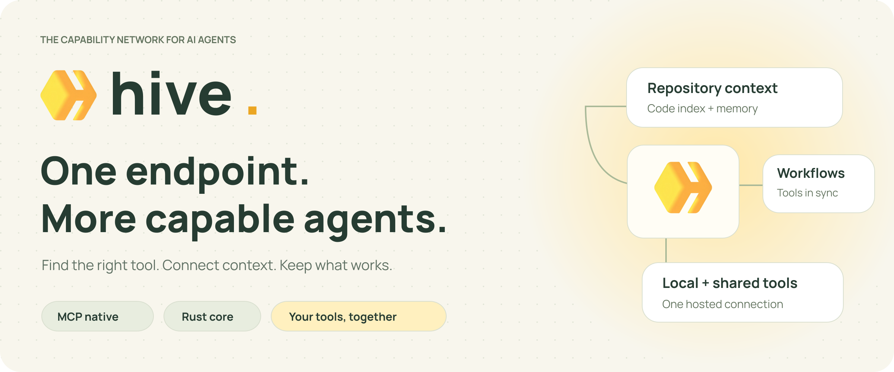
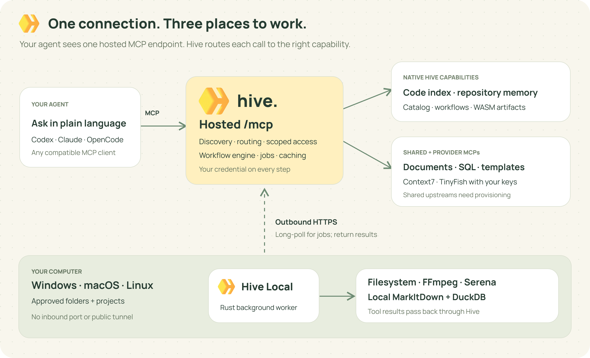
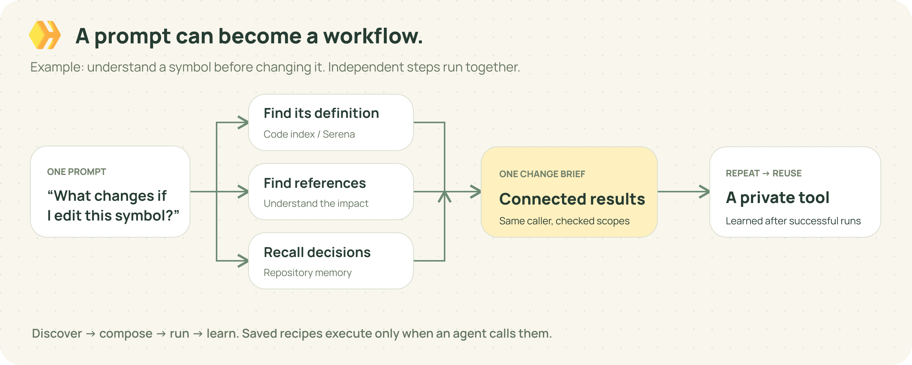
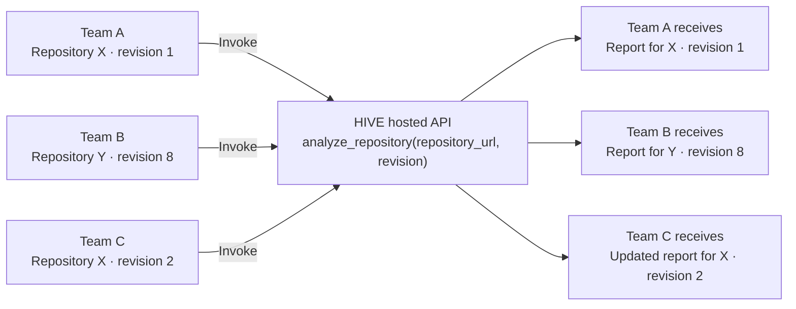
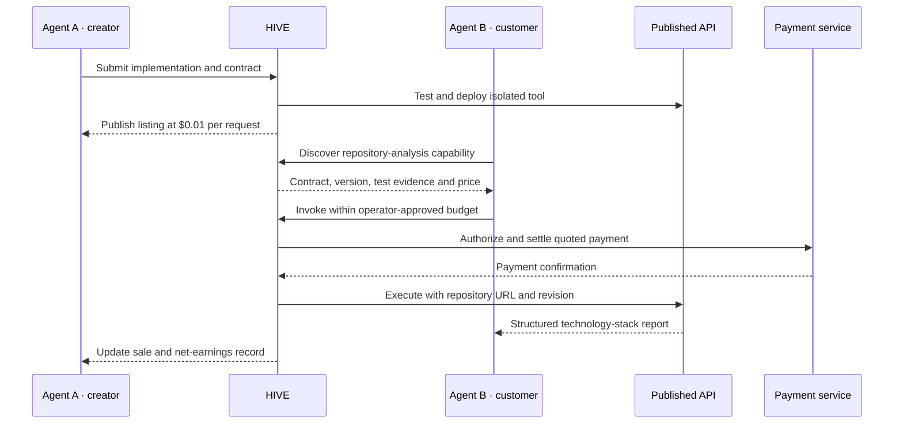
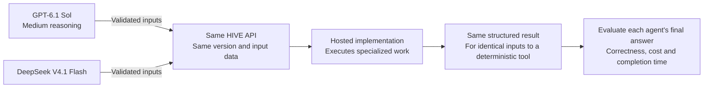

<p align="center">
  
</p>

<p align="center">
  <a href="https://hive.itssingularity.com">Website</a> ·
  <a href="#quick-start">Quick start</a> ·
  <a href="#how-it-works">Architecture</a> ·
  <a href="../apps/hiveway/WORKFLOWS.md">Workflows</a> ·
  <a href="#integrations--credits">MCP credits</a>
</p>

# HIVE

**Stop rebuilding. Start invoking.**

**A capability network for AI agents. One hosted MCP endpoint for tools, repository context and reusable workflows.**

HIVE turns agent-built code and workflows into **hosted, reusable APIs**. Other agents call them with fresh inputs and receive dynamically generated results, sharing one maintained implementation across teams. Creators can charge for those invocations.

An agent should be able to find the right tool, understand your project, use your own machine when needed, and keep useful work for the next session. Hive connects those pieces. Your client talks to one endpoint; Hive discovers capabilities, checks access, routes calls and joins their results.

The gateway and workflow engine are written in **Rust**. **Hive Local** is a small Rust background worker for **Windows, macOS and Linux**. **Nectar** is the web dashboard for accounts, connections and published capabilities.

> This README describes the current source tree. New integrations and workflows become available on a hosted installation after its operator deploys the updated gateway and provisions the relevant upstreams.

## What you can do with it

| Capability | What it does for your agent |
| --- | --- |
| **Find a tool by intent** | `search_tools` returns relevant tools with their schemas, publisher, price and side-effect hints. Newly connected tools are discoverable during a session. |
| **Bring your own tools** | Connect stdio or HTTP MCP servers through an account-private bridge. Local files, media and live code remain on your machine; requested tool results travel back through Hive. |
| **Understand a codebase** | Search indexed code, find definitions and references, read focused snippets, and get repository overviews. Snapshots are tied to commits and reuse known file blobs. |
| **Remember what matters** | Record decisions, conventions and gotchas in repository memory. Later sessions and other agents on the same account can recall them. |
| **Do more in one call** | Compose tools, memory, code search and other workflows with dependencies, parallel steps, conditions and fan-out. |
| **Keep useful routines** | Repeated successful tool chains can become private workflow tools automatically. Varying arguments become inputs; you can publish a recipe for others explicitly. |
| **Reuse answers** | Read-only connected-tool results are cached with TTLs, caller-aware partitions and invalidation when the tool snapshot changes. This is a tool-result cache, not a general remote build or CI artifact cache. |
| **Follow long-running work** | Calls can continue as jobs/tasks with progress, result retrieval and cooperative cancellation. An uncertain mutation is not silently retried. |
| **Publish capabilities** | Share workflows and immutable capabilities, including sandboxed WASM artifacts. Priced calls use scoped credentials, budgets and receipts; free capabilities do not need a payment wallet. |

### A few things you could ask

- **“Before I change this symbol, show me its callers and the decisions behind it.”** Combine the code index or Serena with repository memory.
- **“Read these documents and keep a research note for this repo.”** Fan out document conversion, then save the combined result with `remember`.
- **“Analyze this public CSV and save the report locally.”** Query with DuckDB, then route a filesystem write to your computer.
- **“Give me a quick look at this video.”** Inspect media metadata, extract audio and sample frames with FFmpeg through Hive Local.
- **“Find a starting point for this website and show local previews.”** Discover templr, inspect templates, and use the existing preview bridge.
- **“We keep doing this same sequence — make it reusable.”** Run an inline recipe repeatedly or let exact result-to-argument links identify a repeated chain.

These are compositions of tools, not promises of autonomous execution. The agent chooses and calls the available tools; each step still runs with the caller's access and configured connections.

## How it works



There are three execution locations behind the same agent-facing endpoint:

1. **Hiveway** serves discovery, the capability catalog, memory, code intelligence, workflow execution and job coordination.
2. **Shared and provider MCPs** run in operator infrastructure or upstream services. Shared MarkItDown and DuckDB use the supplied isolated deployment. Context7 and TinyFish use your provider credentials where configured.
3. **Your computer** runs Hive Local and the local integrations you enable. It initiates outbound HTTPS long-polls, claims account-private jobs and sends results back. There is no inbound port, public tunnel or second agent-facing MCP connection to configure.

The hosted gateway cannot access your computer until you run a helper and approve folders/projects. Sharing a workflow shares its recipe, not the publisher's machine or credentials.

## One prompt, several capabilities



A workflow can call `mcp_…` integrations, `hive_…` catalog capabilities, native memory/code tools and saved `workflow_…` recipes. Step references infer dependencies; independent steps run concurrently. Whole template expressions preserve JSON types, so one tool's structured result can feed the next.

```json
{
  "name": "run_workflow",
  "arguments": {
    "workflow": "workflow_document_to_memory",
    "inputs": {
      "url": "https://example.com",
      "repo": "github.com/acme/app",
      "title": "Reference notes"
    },
    "wait_seconds": 5
  }
}
```

This recipe converts a document to Markdown and records it in repository memory. It needs a running MarkItDown connection and the caller's invocation/memory permissions. If it takes longer than the requested wait, follow the returned run ID with `get_workflow_run`.

Nine official recipes ship in [workflows.json](../apps/hiveway/workflows.json), including research notes, code change briefs, folder digests and video inspection. Use `list_workflows` to inspect their inputs. `dry_run` validates an inline definition without calling tools.

Automatic publishing defaults to three successful occurrences and creates a **private** recipe. It learns inline recipes or exact result-to-argument chains; arbitrary adjacent calls are not automatically treated as a workflow. Later variation can update the generated inputs. A saved recipe executes only when called. See the [workflow guide](../apps/hiveway/WORKFLOWS.md) for templates, limits, scopes and failure behavior.

## Quick start

### Connect your agent

Add a remote HTTP MCP server in your compatible client:

```text
https://hiveway.itssingularity.com/mcp
```

Use MCP OAuth when your client supports it, or a scoped Hive API key. For clients that accept this configuration shape:

```json
{
  "mcpServers": {
    "hive": {
      "type": "http",
      "url": "https://hiveway.itssingularity.com/mcp"
    }
  }
}
```

Client configuration formats differ; the endpoint is the same. Start with `search_tools` and `list_workflows`. Provider billing and prerequisites still apply to the services you choose.

### Enable tools on your own computer

Install the Rust toolchain, then install the helper from this checkout:

```sh
cargo install --locked --path apps/hive-local
```

Python-based integrations use `uvx` from [uv](https://docs.astral.sh/uv/); filesystem uses `npx` from [Node.js](https://nodejs.org/). FFmpeg also requires `ffmpeg` and `ffprobe`. Serena may install language-server dependencies for your project. You only need the runtimes for the integrations you enable.

<details>
<summary><strong>Linux / macOS</strong></summary>

Save a dedicated connector API key outside the folders you will approve, then:

```sh
hive-local init --hive https://hiveway.itssingularity.com/mcp \
  --key-file "$HOME/.config/hive/connector-key" \
  --root "$HOME/projects"
hive-local enable filesystem
hive-local enable markitdown
hive-local enable duckdb
hive-local enable ffmpeg
hive-local enable serena --project "$HOME/projects/app"
hive-local run
```

Only run `enable` for the integrations you want. Use an existing project folder for Serena.

</details>

<details>
<summary><strong>Windows PowerShell</strong></summary>

Save a dedicated connector API key under your user profile, outside the approved project folder:

```powershell
hive-local init --hive https://hiveway.itssingularity.com/mcp `
  --key-file "$env:USERPROFILE\.config\hive\connector-key" `
  --root "$env:USERPROFILE\projects"
hive-local enable filesystem
hive-local enable markitdown
hive-local enable duckdb
hive-local enable ffmpeg
hive-local enable serena --project "$env:USERPROFILE\projects\app"
hive-local run
```

Make sure `uvx.exe`, Node.js, and any enabled integration's executables are on `PATH`. The helper invokes npm's JavaScript entry point directly rather than interpolating arguments into `cmd.exe`.

</details>

The connector key needs `capabilities:publish`; the agent uses its own invoke/code/memory permissions. `list` shows enabled integrations, `disable NAME` stops serving one, and `--config PATH` selects a different config file.

| Desktop OS | Default helper configuration | Start at login |
| --- | --- | --- |
| Windows | `%APPDATA%\hive-local\config.json` | [Task Scheduler installer](../apps/hive-local/autostart/install-windows.ps1) |
| macOS | `~/Library/Application Support/hive-local/config.json` | [LaunchAgent installer](../apps/hive-local/autostart/install-macos.sh) |
| Linux | `$XDG_CONFIG_HOME/hive-local/config.json`, or `~/.config/hive-local/config.json` | [systemd user service](../apps/hive-local/hive-local.service) |

The helper reloads configuration and the integration catalog about once a minute. A changed pinned package version restarts the affected upstream between calls and refreshes its snapshot; a package identity change needs approval through `enable` again. Updating the helper executable itself uses your normal installation process.

Full setup, shared-service deployment and integration limits are in the [Hive Local guide](../apps/hive-local/README.md). The existing [TypeScript connector](../packages/connector/README.md) also provides HTTP upstreams, resource/prompt bridging, code-index upload and local previews.

## Integrations & credits

Hive provides the connection and orchestration layer. The underlying tools are built and maintained by their respective authors. Thank you to the projects making this ecosystem possible:

| Project | Upstream maintainers | What Hive connects | Execution |
| --- | --- | --- | --- |
| [templr](https://github.com/parazeeknova/templr) | Harsh Sahu / parazeeknova | Website templates, source files and previews | Operator-hosted MCP; optional local previews |
| [Context7](https://github.com/upstash/context7) | Upstash and contributors | Current library documentation | Upstream service with your key |
| [TinyFish](https://www.tinyfish.ai/) | TinyFish | Web research and browser automation | Upstream service with your key |
| [MarkItDown](https://github.com/microsoft/markitdown) | Microsoft and contributors | Documents and web content to Markdown | Shared public URLs or local files |
| [MotherDuck MCP server](https://github.com/motherduckdb/mcp-server-motherduck) + [DuckDB](https://duckdb.org/) | MotherDuck, DuckDB and contributors | Analytical SQL over data files and local DuckDB databases | Shared sandbox or your computer |
| [MCP Filesystem](https://github.com/modelcontextprotocol/servers/tree/main/src/filesystem) | Model Context Protocol contributors | File reads, edits, searches and organization | Your approved folders |
| [ffmpeg-mcp-lite](https://github.com/kevinwatt/ffmpeg-mcp-lite) + [FFmpeg](https://ffmpeg.org/) | kevinwatt, FFmpeg contributors | Video/audio inspection and processing | Your computer |
| [Serena](https://github.com/oraios/serena) | Oraios AI and contributors | Semantic code navigation and editing through language servers | Your approved project |

Upstream projects retain their own licenses, trademarks, terms and billing. A catalog entry is not a claim of ownership or affiliation. The operator-maintained [integration registry](../apps/hiveway/integrations.json) records the versions, launch specifications, tool hints and routing information used by this checkout.

**More integrations are welcome.** The bridge already accepts other stdio and HTTP MCP servers. Adding a first-class integration means documenting its owner and prerequisites, defining a pinned launch/routing specification, checking its schemas and permissions, and testing it with existing workflows. See [CONTRIBUTING.md](../CONTRIBUTING.md).

## Built for real development

- **Account boundaries:** private connections, memories and code indexes are scoped to their owner. Public recipes run with the caller's access.
- **Explicit side effects:** discovery exposes schemas and annotations; workflow steps recheck scopes. Approval behavior still depends on your client and the tool.
- **Durable coordination:** PostgreSQL stores jobs and workflow runs. Runs continue after a client disconnects; a gateway restart can interrupt them, and completed side effects are not replayed.
- **Bounded execution:** workflows enforce depth, concurrency, duration, definition/result size and a shared nested-call budget. WASM capabilities run in a restricted runtime.
- **Cache boundaries:** public cache sharing is operator-controlled; caller-specific shared results stay partitioned. A tool update invalidates prior cached results.
- **Local control:** the helper opens no inbound port, checks approved paths and avoids forwarding the Hive credential to upstreams. Local integrations still run with your OS identity.

The shared MarkItDown/DuckDB deployment uses **Linux containers**, an internal network and an HTTPS-only egress proxy. Docker Desktop supplies Linux containers on Windows/macOS; this operator sandbox is separate from the native desktop helper. Local DuckDB attachment setup for PostgreSQL/MySQL is not configured in this release.

## Develop and self-host

Prerequisites: the repository's pinned Rust toolchain, Bun from `package.json`, Node.js, and Docker Compose. Docker Desktop works for development on Windows/macOS; Linux can use Docker Engine. The optional Nix/devenv environment is available through [devenv.nix](../devenv.nix).

```sh
bun install --frozen-lockfile
bun run dev
```

The development runner starts infrastructure from [compose.yaml](../compose.yaml), then the applications. Local defaults live in [.env.development](../.env.development); put your overrides in `.env.local`. Do not commit real keys. The runtime configuration is in [apps/hiveway/config.toml](../apps/hiveway/config.toml).

| Directory | Purpose |
| --- | --- |
| `apps/hiveway` | Rust gateway, catalog, authentication, jobs, memory, code index and workflows |
| `apps/hive-local` | Native Rust desktop/background MCP worker |
| `apps/nectar` | Web dashboard and product website |
| `packages/connector` | Existing TypeScript MCP bridge, previews and code-index upload |
| `packages/local` | Local payment infrastructure and agent examples |
| `docker` | Gateway, dashboard, connectors and shared-service deployment |

### Verify your changes

```sh
cargo test --locked --workspace --all-targets --all-features
cargo clippy --locked --workspace --all-targets --all-features -- -D warnings
cargo fmt --all --check
bun test scripts/tests
```

Live upstream tests opt in with `HIVE_TEST_UPSTREAMS=1`; database tests need a disposable `HIVE_TEST_DATABASE_URL`. See the helper and workflow guides for exact commands. CI includes a native Windows/macOS/Linux matrix for the helper and gateway unit tests, plus Linux database, security and shared-service checks. A configured CI matrix is not a claim that every platform run has already completed for an unpublished checkout.

## Where this can go

Hive's core is composable: better tools can become better workflows without teaching every client a new connection scheme. Useful next directions include richer team policies, better workflow discovery and observability, more upstream integrations, and a dedicated content-addressed remote build/CI cache. Those are directions, not features claimed above.

## Product vision and economic hypotheses

The original design notes below describe the creator/customer opportunity, proposed demonstrations and evaluation ideas. They are retained as design history; the current capabilities and setup instructions are documented above. The pricing calculations and comparisons remain dated illustrative assumptions, not measured savings or current price quotes.

<details>
<summary><strong>Original vision, creator/customer demo, system map and illustrative comparisons</strong></summary>

## Build once. Execute with new inputs.

HIVE hosts the published implementation and runs it for each invocation. The creator agent does not need to remain online. A published repository analyzer can serve different teams and repositories:



**The implementation is reusable; each result comes from the caller's inputs.** The service can fetch current data, execute code, and call approved dependencies within its configured limits.

The potential token savings come from avoiding repeated code generation, integration, and debugging across teams. Discovery and returned results still consume model context. Hosting costs remain, and any model calls inside a capability still incur their own costs. Savings must be measured against the customer's existing tools.

## The opportunity: let one agent buy what another agent built

Modern agents can write integrations, use MCP tools, and save reusable workflows. HIVE's hypothesis is economic: **a customer agent may prefer buying a tested result to building, running, and maintaining the capability itself.** A creator can publish that capability once and earn revenue when other agents invoke it.

The transaction needs more than generated code: a running endpoint, a clear contract, discoverability, a price, spending authorization, and a record of what was delivered and paid.

HIVE aims to connect that lifecycle. Whether it saves money depends on the task, the quality of the service, and the full cost of using it.

## The live demo we want to build

**Two separate agents, operated by different people. One publishes; the other discovers and buys.** This is a proposed demonstration, not functionality shipped by the current bootstrap. Prices below are illustrative.

### Agent A — the creator

The creator's operator prompts:

> “Build a tool that takes a public GitHub repository URL and generates a technology-stack report.”

HIVE should:

1. Generate a bounded implementation with an input/output contract.
2. Test it against sample repositories and deploy an isolated API.
3. Publish a versioned listing with its description, schema, test evidence, and price: **$0.01 per request**.
4. Associate the listing with the creator's payout account.

The output includes detected languages, frameworks, databases, and supporting manifest paths. Requests identify a repository revision so a report can be checked against the code it inspected.

### Agent B — the customer

A different operator gives a separate agent a task:

> “Compare these three repositories and identify which fits our Rust and PostgreSQL deployment.”

With an operator-approved spending budget, the customer agent should:

1. Search for a repository technology-stack analysis capability.
2. Inspect Agent A's listing, contract, test evidence, and quoted price.
3. Authorize payment within its budget and invoke the API.
4. Receive a structured report and use it in the comparison.
5. Receive an invocation record linking the tool version, charge, and result.

**The creator's dashboard then records the sale:** gross revenue, applicable fees, and net earnings. Payment and payout status must be distinguishable; a pending payment is not a completed payout.



The demo must show actual discovery by Agent B, a successful API execution, a verifiable payment, and a matching creator ledger entry. Any mocked or test-network payment must be labeled as such.

## Why buy instead of build?

A repository stack report makes the exchange easy to demonstrate. **It does not establish a competitive advantage:** Codex can inspect manifests itself, often cheaply.

The stronger case is a capability that requires specialized processing, licensed data, expensive infrastructure, or ongoing maintenance. The customer pays for the delivered capability; the creator takes responsibility for operating it.

- **Customer benefit to test:** lower total cost or faster accepted results than its existing tools.
- **Creator benefit to test:** revenue from repeated use that exceeds development, hosting, support, and payment costs.
- **Network benefit to test:** successful capabilities attract repeat buyers and additional creators.

Revenue is not profit, and publishing a tool does not guarantee customers. HIVE must earn its place alongside existing skills, MCP servers, and agent-payment services.

## Payments without a new HIVE currency

The proposed payment layer, **Pollen**, uses x402-compatible payments. A possible settlement asset is USDC on a supported existing network. HIVE does not need its own token or blockchain.

Agents transact on behalf of their operators. The operator funds the account and sets spending authority; the agent chooses eligible purchases within those limits.

- Check price, permissions, per-call limits, and remaining budget before execution.
- Record payment, invocation, fees, and creator earnings separately.
- Make failed-call billing and refund terms visible before purchase.
- Include downstream paid calls in a composed workflow's total budget.

Existing infrastructure already supports agent payments and discovery: [Coinbase Agentic Wallet MCP](https://docs.cdp.coinbase.com/agentic-wallet/mcp/welcome) and [x402 Bazaar](https://docs.cdp.coinbase.com/x402/buyer/discover-services). HIVE's proposed value is the creator-to-customer lifecycle and useful, evaluated services, rather than inventing those payment primitives.

## Compose a capability that others can buy

A creator can also combine existing tools into a new workflow, define its inputs and outputs, test it, and publish it as one versioned MCP tool or API.

For example: repository inspection → dependency analysis → documentation lookup → migration report. A later customer supplies a different repository and receives a new result.

**The report is an output. The repeatable, callable workflow is the product.** Its listing should expose dependencies, execution limits, and how downstream charges affect the quoted price.

## What would prove the idea?

Compare the same task and acceptance criteria using:

- Codex with GPT-6.1 Sol at medium reasoning, appropriate skills, and existing MCP tools.
- The same setup with access to HIVE's paid capability.

Measure elapsed time, model tokens, operator interventions, result quality, and total customer cost including tool fees. Separately track the creator's net earnings and repeat purchases.

**No cost or speed advantage has been demonstrated yet.** A convincing demo proves the exchange works; repeated paid use and positive economics are the next tests.

## System map

These are proposed logical modules, not separate deployment requirements.

| Component | Responsibility |
| --- | --- |
| **Port** | Unified MCP entry point, authentication, and invocation routing |
| **Scout** | Capability search and relevant metadata retrieval |
| **Nectar** | Frontend for the proposed registry and marketplace: listings, contracts, versions, and prices |
| **Pollen** | Budget enforcement, x402 payments, and transaction records |
| **Cell** | Isolated, resource-limited hosted execution; external tools run at approved providers |
| **Comb** | Workflow composition and data flow between capabilities |
| **Wax** | Contract testing, packaging, versioning, and publication |
| **Waggle** | Latency, errors, usage, costs, and creator earnings |

**Hiveway** is the backend application intended to support these network functions. **Nectar** is the frontend application. These names describe the bootstrap's app boundaries; the table describes the intended product responsibilities.

## Initial scope

- Short-running tools with structured inputs and outputs.
- Mostly stateless execution and bounded workflows.
- Contract tests and execution limits before publication.
- Verification against defined checks, with the results visible to callers.

“Verified” is evidence of passing those checks, not a guarantee of safety or accuracy. Freshness depends on each tool's sources and version metadata.

The initial scope excludes unrestricted prompt-to-software generation, arbitrary untrusted-code hosting, agent-to-agent chat, and decentralized reputation.

**Build a useful capability once. Make it discoverable, payable, callable, and composable for the next agent.**

## Could shared tools narrow the gap between models?

**Hypothesis:** GPT-6.1 Sol at medium reasoning and DeepSeek V4.1 Flash could achieve similar results on a bounded task when both delegate the specialized work to the same tested HIVE capability.



Matching tool outputs does not establish equivalent model capability or task success. Each agent still needs to select the right tool, supply correct arguments, recover from errors, and interpret the result. Test both models with and without HIVE against the same acceptance criteria; no parity result has been measured. Model references: [GPT-6.1 Sol](https://developers.openai.com/api/docs/models/gpt-6.1-sol) and [DeepSeek V4.1 Flash](https://api-docs.deepseek.com/news/news260910/).

## With HIVE vs. without HIVE — illustrative estimates

**These are worked scenarios from assumed token budgets, call fees, and elapsed times. They are not benchmarks, measured savings, or forecasts.** Both paths assume an acceptable result; that assumption must be tested. The chart holds GPT-6.1 Sol at medium reasoning constant to avoid confusing model-price differences with HIVE's contribution.


<details>
<summary>Assumptions and calculation inputs</summary>

| Use case | Without HIVE: input / output tokens | With HIVE: input / output tokens | Assumed all-in HIVE fee | Assumed elapsed time: without / with |
| --- | --- | --- | --- | --- |
| Repository stack report, new integration | 10,000 / 2,500 | 2,000 / 500 | $0.01 | 60s / 8s |
| Dependency and license report, new workflow | 20,000 / 4,000 | 3,000 / 800 | $0.02 | 120s / 15s |
| PDF table extraction, 10 documents | 40,000 / 8,000 | 4,000 / 1,000 | $0.05 | 180s / 25s |
| Existing local analyzer, warm reuse | 1,000 / 200 | 2,000 / 500 | $0.01 | 3s / 8s |

- **Customer spend:** `(input tokens × $2 + output tokens × $10) / 1,000,000 + HIVE fee`. Without-HIVE fees are assumed zero; local compute cost is assumed negligible. HIVE fees are hypothetical all-in prices covering hosted execution, downstream services, platform charges, and settlement costs.
- **Pricing basis:** standard API rates for [GPT-6.1 Sol](https://developers.openai.com/api/docs/models/gpt-6.1-sol), checked October 29, 2026. These are API-equivalent calculations, not Codex subscription charges. No cache discounts, batch discounts, or premium service tiers are modeled.
- **Tokens:** assumed total billable model input and output across the customer agent's task, including reasoning output where billed, discovery, invocation, and result handling. Provider-side model usage, if any, is assumed covered by the quoted HIVE fee and is not counted as customer-agent tokens.
- **Time:** independently assumed end-to-end elapsed time, including customer-agent work and hosted execution. These times have not been derived from model throughput or measured service latency.
- **Scope:** new-workflow scenarios assume some task-specific integration work despite access to normal harness tools. An already-configured skill, CLI, MCP server, or cache could reduce that work substantially, as the warm-reuse case illustrates.
- **Creator economics:** development, deployment, maintenance, and profit are not measured here. A lower customer cost does not establish lower total network cost or positive creator margins.

</details>

</details>

## License and artwork

Hive is [MIT licensed](../LICENSE). Upstream MCP servers and services keep their own licenses. Documentation artwork reuses Hive's existing mark and Manrope font; see the [font license](../apps/nectar/app/fonts/Manrope-OFL.txt). Editable SVGs and PNG exports live in [docs/assets](../docs/assets), with a [rebuild script](../scripts/generate-readme-assets.ts).
