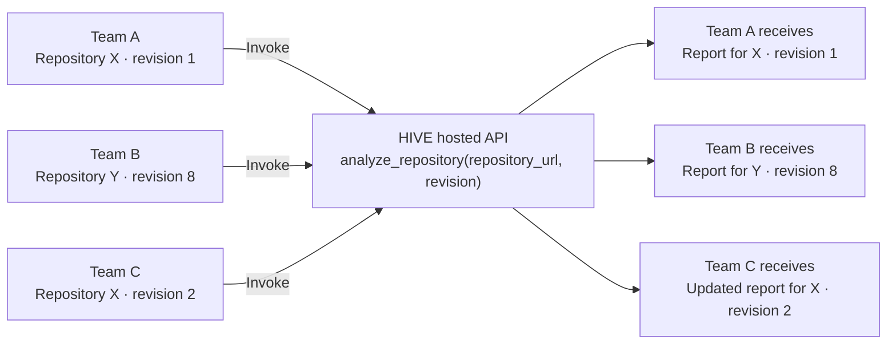
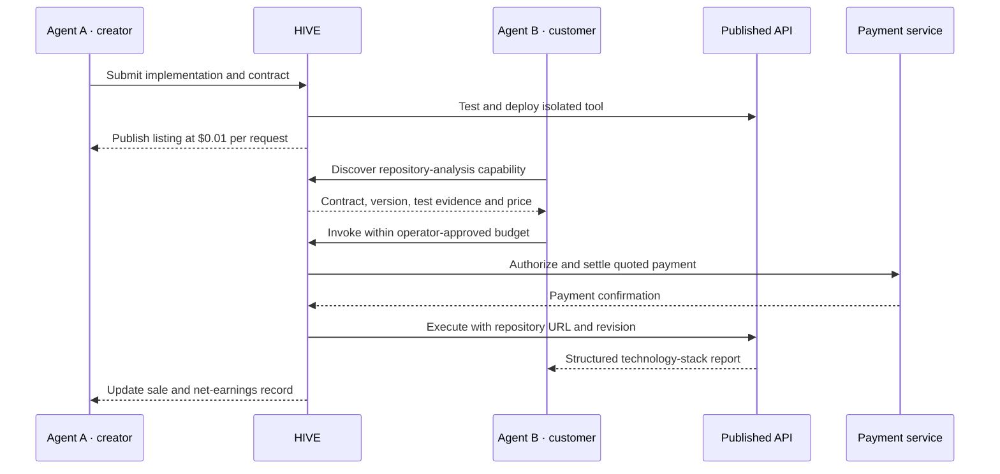
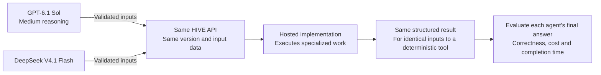

# HIVE

**Stop rebuilding. Start invoking.**

HIVE turns agent-built code and workflows into **hosted, reusable APIs**. Other agents call them with fresh inputs and receive dynamically generated results, sharing one maintained implementation across teams. Creators can charge for those invocations.

## Build once. Execute with new inputs.

HIVE hosts the published implementation and runs it for each invocation. The creator agent does not need to remain online. A published repository analyzer can serve different teams and repositories:

**The implementation is reusable; each result comes from the caller's inputs.** The service can fetch current data, execute code, and call approved dependencies within its configured limits.

The potential token savings come from avoiding repeated code generation, integration, and debugging across teams. Discovery and returned results still consume model context. Hosting costs remain, and any model calls inside a capability still incur their own costs. Savings must be measured against the customer's existing tools.

## The opportunity: let one agent buy what another agent built

Modern agents can write integrations, use MCP tools, and save reusable workflows. HIVE's hypothesis is economic: **a customer agent may prefer buying a tested result to building, running, and maintaining the capability itself.** A creator can publish that capability once and earn revenue when other agents invoke it.

The transaction needs more than generated code: a running endpoint, a clear contract, discoverability, a price, spending authorization, and a record of what was delivered and paid.

HIVE aims to connect that lifecycle. Whether it saves money depends on the task, the quality of the service, and the full cost of using it.

## The live demo we want to build

**Two separate agents, operated by different people. One publishes; the other discovers and buys.** This is a proposed demonstration, not functionality shipped by the current bootstrap. Prices below are illustrative.

### Agent A — the creator

The creator's operator prompts:

> “Build a tool that takes a public GitHub repository URL and generates a technology-stack report.”

HIVE should:

1. Generate a bounded implementation with an input/output contract.
2. Test it against sample repositories and deploy an isolated API.
3. Publish a versioned listing with its description, schema, test evidence, and price: **$0.01 per request**.
4. Associate the listing with the creator's payout account.

The output includes detected languages, frameworks, databases, and supporting manifest paths. Requests identify a repository revision so a report can be checked against the code it inspected.

### Agent B — the customer

A different operator gives a separate agent a task:

> “Compare these three repositories and identify which fits our Rust and PostgreSQL deployment.”

With an operator-approved spending budget, the customer agent should:

1. Search for a repository technology-stack analysis capability.
2. Inspect Agent A's listing, contract, test evidence, and quoted price.
3. Authorize payment within its budget and invoke the API.
4. Receive a structured report and use it in the comparison.
5. Receive an invocation record linking the tool version, charge, and result.

**The creator's dashboard then records the sale:** gross revenue, applicable fees, and net earnings. Payment and payout status must be distinguishable; a pending payment is not a completed payout.

The demo must show actual discovery by Agent B, a successful API execution, a verifiable payment, and a matching creator ledger entry. Any mocked or test-network payment must be labeled as such.

## Why buy instead of build?

A repository stack report makes the exchange easy to demonstrate. **It does not establish a competitive advantage:** Codex can inspect manifests itself, often cheaply.

The stronger case is a capability that requires specialized processing, licensed data, expensive infrastructure, or ongoing maintenance. The customer pays for the delivered capability; the creator takes responsibility for operating it.

- **Customer benefit to test:** lower total cost or faster accepted results than its existing tools.
- **Creator benefit to test:** revenue from repeated use that exceeds development, hosting, support, and payment costs.
- **Network benefit to test:** successful capabilities attract repeat buyers and additional creators.

Revenue is not profit, and publishing a tool does not guarantee customers. HIVE must earn its place alongside existing skills, MCP servers, and agent-payment services.

## Payments without a new HIVE currency

The proposed payment layer, **Pollen**, uses x402-compatible payments. A possible settlement asset is USDC on a supported existing network. HIVE does not need its own token or blockchain.

Agents transact on behalf of their operators. The operator funds the account and sets spending authority; the agent chooses eligible purchases within those limits.

- Check price, permissions, per-call limits, and remaining budget before execution.
- Record payment, invocation, fees, and creator earnings separately.
- Make failed-call billing and refund terms visible before purchase.
- Include downstream paid calls in a composed workflow's total budget.

Existing infrastructure already supports agent payments and discovery: [Coinbase Agentic Wallet MCP](https://docs.cdp.coinbase.com/agentic-wallet/mcp/welcome) and [x402 Bazaar](https://docs.cdp.coinbase.com/x402/buyer/discover-services). HIVE's proposed value is the creator-to-customer lifecycle and useful, evaluated services, rather than inventing those payment primitives.

## Compose a capability that others can buy

A creator can also combine existing tools into a new workflow, define its inputs and outputs, test it, and publish it as one versioned MCP tool or API.

For example: repository inspection → dependency analysis → documentation lookup → migration report. A later customer supplies a different repository and receives a new result.

**The report is an output. The repeatable, callable workflow is the product.** Its listing should expose dependencies, execution limits, and how downstream charges affect the quoted price.

## What would prove the idea?

Compare the same task and acceptance criteria using:

- Codex with GPT-6.1 Sol at medium reasoning, appropriate skills, and existing MCP tools.
- The same setup with access to HIVE's paid capability.

Measure elapsed time, model tokens, operator interventions, result quality, and total customer cost including tool fees. Separately track the creator's net earnings and repeat purchases.

**No cost or speed advantage has been demonstrated yet.** A convincing demo proves the exchange works; repeated paid use and positive economics are the next tests.

## System map

These are proposed logical modules, not separate deployment requirements.

| Component | Responsibility |
| --- | --- |
| **Port** | Unified MCP entry point, authentication, and invocation routing |
| **Scout** | Capability search and relevant metadata retrieval |
| **Nectar** | Frontend for the proposed registry and marketplace: listings, contracts, versions, and prices |
| **Pollen** | Budget enforcement, x402 payments, and transaction records |
| **Cell** | Isolated, resource-limited hosted execution; external tools run at approved providers |
| **Comb** | Workflow composition and data flow between capabilities |
| **Wax** | Contract testing, packaging, versioning, and publication |
| **Waggle** | Latency, errors, usage, costs, and creator earnings |

**Hiveway** is the backend application intended to support these network functions. **Nectar** is the frontend application. These names describe the bootstrap's app boundaries; the table describes the intended product responsibilities.

## Initial scope

- Short-running tools with structured inputs and outputs.
- Mostly stateless execution and bounded workflows.
- Contract tests and execution limits before publication.
- Verification against defined checks, with the results visible to callers.

“Verified” is evidence of passing those checks, not a guarantee of safety or accuracy. Freshness depends on each tool's sources and version metadata.

The initial scope excludes unrestricted prompt-to-software generation, arbitrary untrusted-code hosting, agent-to-agent chat, and decentralized reputation.

**Build a useful capability once. Make it discoverable, payable, callable, and composable for the next agent.**

## Could shared tools narrow the gap between models?

**Hypothesis:** GPT-6.1 Sol at medium reasoning and DeepSeek V4.1 Flash could achieve similar results on a bounded task when both delegate the specialized work to the same tested HIVE capability.

Matching tool outputs does not establish equivalent model capability or task success. Each agent still needs to select the right tool, supply correct arguments, recover from errors, and interpret the result. Test both models with and without HIVE against the same acceptance criteria; no parity result has been measured. Model references: [GPT-6.1 Sol](https://developers.openai.com/api/docs/models/gpt-6.1-sol) and [DeepSeek V4.1 Flash](https://api-docs.deepseek.com/news/news260910/).

## With HIVE vs. without HIVE — illustrative estimates

**These are worked scenarios from assumed token budgets, call fees, and elapsed times. They are not benchmarks, measured savings, or forecasts.** Both paths assume an acceptable result; that assumption must be tested. The chart holds GPT-6.1 Sol at medium reasoning constant to avoid confusing model-price differences with HIVE's contribution.

Assumptions and calculation inputs

| Use case | Without HIVE: input / output tokens | With HIVE: input / output tokens | Assumed all-in HIVE fee | Assumed elapsed time: without / with |
| --- | --- | --- | --- | --- |
| Repository stack report, new integration | 10,000 / 2,500 | 2,000 / 500 | $0.01 | 60s / 8s |
| Dependency and license report, new workflow | 20,000 / 4,000 | 3,000 / 800 | $0.02 | 120s / 15s |
| PDF table extraction, 10 documents | 40,000 / 8,000 | 4,000 / 1,000 | $0.05 | 180s / 25s |
| Existing local analyzer, warm reuse | 1,000 / 200 | 2,000 / 500 | $0.01 | 3s / 8s |

- **Customer spend:** `(input tokens × $2 + output tokens × $10) / 1,000,000 + HIVE fee`. Without-HIVE fees are assumed zero; local compute cost is assumed negligible. HIVE fees are hypothetical all-in prices covering hosted execution, downstream services, platform charges, and settlement costs.
- **Pricing basis:** standard API rates for [GPT-6.1 Sol](https://developers.openai.com/api/docs/models/gpt-6.1-sol), checked October 29, 2026. These are API-equivalent calculations, not Codex subscription charges. No cache discounts, batch discounts, or premium service tiers are modeled.
- **Tokens:** assumed total billable model input and output across the customer agent's task, including reasoning output where billed, discovery, invocation, and result handling. Provider-side model usage, if any, is assumed covered by the quoted HIVE fee and is not counted as customer-agent tokens.
- **Time:** independently assumed end-to-end elapsed time, including customer-agent work and hosted execution. These times have not been derived from model throughput or measured service latency.
- **Scope:** new-workflow scenarios assume some task-specific integration work despite access to normal harness tools. An already-configured skill, CLI, MCP server, or cache could reduce that work substantially, as the warm-reuse case illustrates.
- **Creator economics:** development, deployment, maintenance, and profit are not measured here. A lower customer cost does not establish lower total network cost or positive creator margins.

